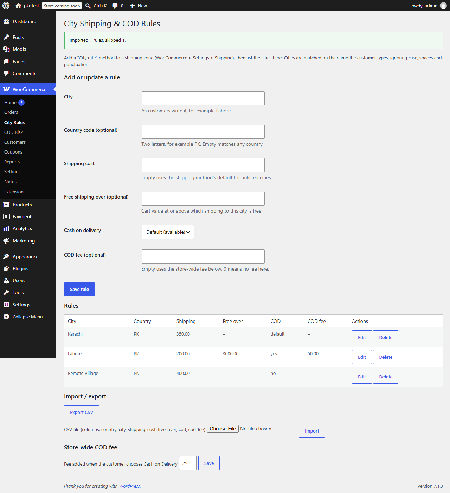

# City Shipping & COD Rules

Charge shipping by city, allow or block cash on delivery per city, and add a COD fee, for WooCommerce stores where couriers price by city.

    



## Why
WooCommerce shipping zones match a country, a state or a postcode, never a city. Where couriers price by city (much of South Asia, MENA and Latin America) that means hacks. WooCommerce's own Cash on Delivery gateway is also just on or off. There is an official [feature request for shipping by city](https://woocommerce.com/feature-request/shipping-by-city/).

## Features
- A **City rate** shipping method for any shipping zone, priced from a table of cities.
- Per-city shipping cost; a default for unlisted cities (or no shipping to them).
- Free shipping over a cart value, per city.
- Cash on Delivery on or off per city. WooCommerce re-checks the chosen method when the order is placed, so it cannot be bypassed.
- A COD fee: store-wide default, overridable per city (an explicit 0 means none).
- CSV import and export; WP-CLI commands.
- Block checkout and classic checkout; HPOS compatible.

## Installation
**Zip:** upload the release zip under Plugins > Add New. **Manual:** copy `city-shipping-cod-rules` to `wp-content/plugins/`. WooCommerce must be active.

## Usage
1. WooCommerce > Settings > Shipping: add the **City rate** method to a zone and set its "cost for cities not in the table" (empty = no shipping to unlisted cities).
2. WooCommerce > City Rules: add cities, or import a CSV.

## WP-CLI
```bash
wp cityrules list
wp cityrules import cities.csv
wp cityrules export > cities.csv
```
CSV columns: `country, city, shipping_cost, free_over, cod, cod_fee`. `cod` is `default`, `yes` or `no`.

## Hooks
See [docs/hooks.md](docs/hooks.md).

## FAQ
**What if the customer spells the city differently?** It will not match. Matching ignores case, spaces and punctuation but not accents. Add common spellings as extra rows.
**Does the COD fee work on the block checkout?** Tested on WooCommerce 11.2.1, where the block checkout records the chosen payment method on the server. Older versions are not tested, which is why the minimum is 11.0.

## Development
```bash
composer install
composer lint && composer stan && composer test:unit
npx @wordpress/env start
```
See [TESTING.md](TESTING.md).

## Roadmap
City dropdown at checkout, per-product-class rates, weight-based rates, accent folding.

## Contributing
See [CONTRIBUTING.md](CONTRIBUTING.md). Security: [SECURITY.md](SECURITY.md).

## License
GPL-2.0-or-later.